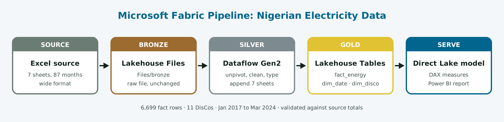
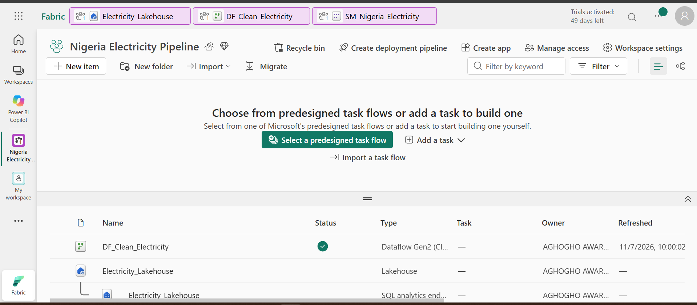
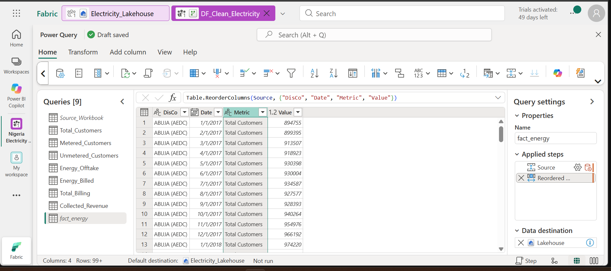
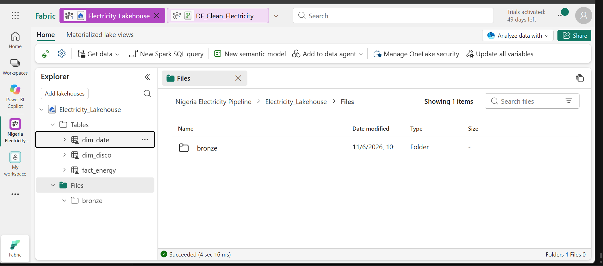
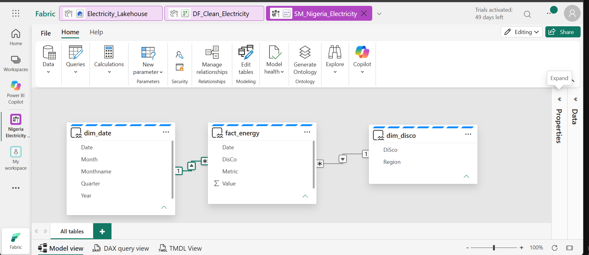
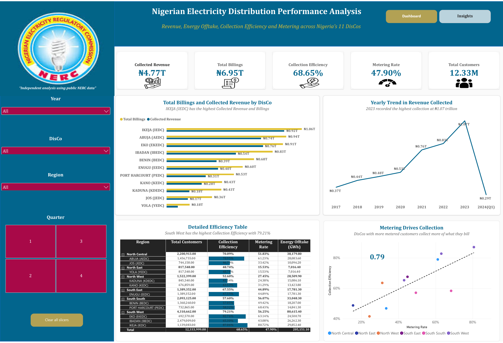
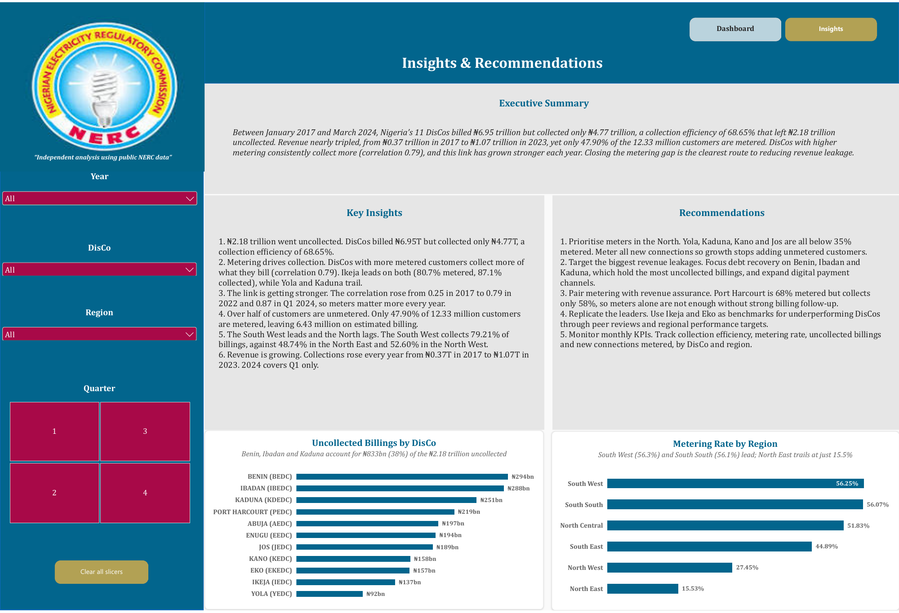

# Nigerian Electricity Data Pipeline in Microsoft Fabric

An end-to-end **Microsoft Fabric** project that takes raw Excel data on Nigeria's 11 electricity distribution companies (DisCos), cleans it through a **medallion architecture** (Bronze → Silver → Gold), and serves it through a **Direct Lake** semantic model and Power BI report.

This project builds on my [Nigerian Electricity Distribution dashboard](https://github.com/Aghogho-data/nigeria-electricity-distribution-dashboard), rebuilt as a proper cloud data pipeline using the skills from my **Microsoft Certified: Fabric Analytics Engineer Associate (DP-600)** certification.

---

## 📌 Why this project

The source data arrives as an Excel workbook with **7 sheets in "wide" format**, one column for each of 87 months. That layout is easy to read but hard to analyse. This pipeline:

1. Stores the raw file untouched (**Bronze**).
2. Reshapes and cleans every sheet into one tidy table (**Silver**).
3. Publishes a star schema of fact and dimension tables (**Gold**).
4. Serves it through a **Direct Lake** model, so the report reads the lakehouse tables directly, with no data import or scheduled refresh.

## 🛠️ Fabric items and skills

| Item | Name | Purpose |
|---|---|---|
| **Workspace** (Fabric trial capacity) | Nigeria Electricity Pipeline | Holds all project items |
| **Lakehouse** | Electricity_Lakehouse | Bronze files and Gold Delta tables in OneLake |
| **Dataflow Gen2** | DF_Clean_Electricity | Power Query transformations and lakehouse data destinations |
| **Semantic model** (Direct Lake) | SM_Nigeria_Electricity | Relationships, date table and DAX measures |
| **Power BI report** | RPT_Nigeria_Electricity | 2-page report: dashboard and insights |

**Skills shown:** OneLake, lakehouse files and tables, medallion architecture, Dataflow Gen2 (unpivot, append, data types, error handling), data destinations, star schema modelling, Direct Lake, DAX (including a Pearson correlation measure), data validation and report design.

---

## 🥉 Bronze: raw data

The original Excel workbook is uploaded unchanged to **Files/bronze** in the lakehouse, so the pipeline can always be re-run from the original source.

## 🥈 Silver: Dataflow Gen2

Each of the 7 sheets (Total, Metered and Unmetered Customers, Energy Offtake, Energy Billed, Total Billing and Collected Revenue) goes through the same steps:

1. Remove the title row and promote the headers.
2. Keep the 11 DisCo rows (one sheet contained extra copies of the table below the data).
3. **Unpivot** the 87 month columns into **Date** and **Value** rows.
4. Set data types (Date and Decimal number).
5. Add a **Metric** column naming the measure.

The 7 cleaned queries are then **appended** into one table: `DisCo | Date | Metric | Value`.

## 🥇 Gold: lakehouse tables

| Table | Rows | Description |
|---|---|---|
| `fact_energy` | 6,699 | One row per DisCo, month and metric (11 × 87 × 7) |
| `dim_disco` | 11 | DisCo and geopolitical region |
| `dim_date` | 87 | Date, year, quarter, month, month name and a year label |

## 🔷 Serve: Direct Lake semantic model

A star schema with one-to-many relationships from `dim_disco` and `dim_date` to `fact_energy`, a marked date table, and DAX measures:

| Measure | Logic |
|---|---|
| Collected Revenue, Total Billings | Sum of the metric, converted from ₦ millions to naira |
| Collection Efficiency | Collected Revenue ÷ Total Billings |
| Total and Metered Customers | Customer count at the **latest month** in the selection (not summed across months) |
| Metering Rate | Metered ÷ Total Customers |
| Metering vs Collection Correlation | Pearson correlation across DisCos, ignoring blanks |

---

## 📊 Report

## 💡 Key insights

- **₦2.18 trillion went uncollected.** DisCos billed ₦6.95T but collected ₦4.77T, a collection efficiency of 68.65%.
- **Metering drives collection** (correlation 0.79). Ikeja leads on both (80.7% metered, 87.1% collected), while Yola and Kaduna trail.
- **The link is getting stronger:** the correlation rose from 0.25 in 2017 to 0.79 in 2022 and 0.87 in Q1 2024.
- **Over half of customers are unmetered:** only 47.90% of 12.33 million customers have meters.
- **The South West leads and the North lags:** 79.21% collection efficiency in the South West, against 48.74% in the North East.
- **Revenue is growing:** from ₦0.37T in 2017 to ₦1.07T in 2023. 2024 contains Q1 only.

## ✅ Recommendations

1. Prioritise meters in the North (Yola, Kaduna, Kano and Jos, all below 35% metered).
2. Target revenue recovery at Benin, Ibadan and Kaduna, which hold the largest uncollected billings.
3. Pair metering with revenue assurance: Port Harcourt is 68% metered but collects only 58%.
4. Benchmark underperformers against Ikeja and Eko.
5. Track monthly KPIs by DisCo and region.

---

## 🔍 Data validation and quality

I checked every metric total in the Gold layer against the source workbook. The checks caught and fixed three issues before publishing:

| Issue found | Fix |
|---|---|
| Total Customers was **doubled** (the query was appended twice) | Removed the duplicate from the append step |
| Energy Billed contained **Energy Offtake** data (wrong sheet) | Pointed the query at the correct sheet |
| A stray **blank row** inflated the correlation (0.86 instead of 0.79) | Filtered blanks in the DAX measure and removed blank rows at source |

**Known data gap:** KANO (KEDC) has no metered/unmetered customer figures for **December 2023** (recorded as "-" in the source). It is stored as blank rather than estimated, so 2023 year-end metering figures exclude Kano.

**Units:** billings and revenue in the source are recorded in **₦ millions**; the measures convert them to naira (₦4.77T = ₦4.77 trillion).

## 📁 Repository contents

| File | Description |
|---|---|
| `0-pipeline-diagram.png` | Pipeline overview |
| `1-workspace.png` | Fabric workspace items |
| `2-dataflow.png` | Dataflow Gen2 queries and steps |
| `3-lakehouse.png` | Lakehouse files (Bronze) and tables (Gold) |
| `4-semantic-model.png` | Direct Lake model relationships |
| `5-report-dashboard.png`, `6-report-insights.png` | Report pages |
| `RPT_Nigeria_Electricity_*.pdf` | Report pages exported as PDF |

---

## 👩🏾‍💻 Author

**Aghogho Faith Awaritoma, ACA**, Chartered Accountant & Data Analyst · Microsoft Certified: Power BI Data Analyst & Fabric Analytics Engineer

🔗 [Portfolio](https://aghogho-data.github.io) · [LinkedIn](https://www.linkedin.com/in/awaritomafaith) · [GitHub](https://github.com/Aghogho-data)
